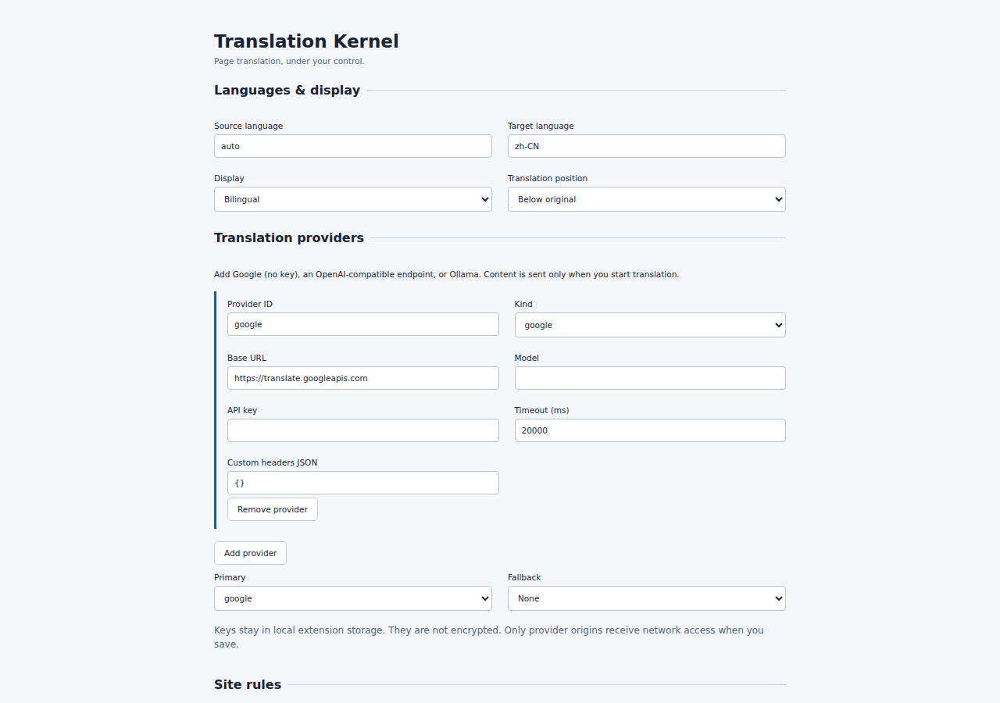

# Translation Kernel

轻量的浏览器翻译内核：提取网页文字、切分语义片段、调度翻译提供商，并可逆地呈现双语文本。

[English](README.md) · [CI](https://github.com/styayur/translation-kernel/actions) · [v0.1.0](https://github.com/styayur/translation-kernel/releases/tag/v0.1.0) · [交付报告](docs/DELIVERY_REPORT.zh-CN.md)

**早期预览版。** 已发布 v0.1.0 Chromium 包，Firefox 交付及所有站点兼容性尚未验证。内核提供原语和 API，外部工具负责工作流；不需要账号或自有后端。



截图来自无 API 密钥的新配置，只证明设置界面，不代表翻译质量。见[捕获步骤](docs/README_SCREENSHOTS.md)。

## 功能与范围

- 纯 TypeScript 内核，文档模型独立于 HTML。
- 按需运行的 Chromium Manifest V3 扩展、紧凑 popup 与设置页。
- 版本化 Provider / Action / Event / Document Adapter 契约。
- 有界上下文、批处理、取消、重试、fallback 和内存 LRU 缓存。

PDF、EPUB、OCR、媒体、词汇、账号、同步、TTS/STT、学习、AI 助手及归档属于外部适配器或工具，不是当前内核功能。

## 安装 v0.1.0

1. 从 [Releases](https://github.com/styayur/translation-kernel/releases) 下载 `translation-kernel-chromium-v0.1.0.zip` 并解压。
2. 打开 `chrome://extensions`，开启开发者模式，选择 Load unpacked，载入含 `manifest.json` 的文件夹。
3. 打开设置，设置源/目标语言并保存，以授权配置的提供商来源。
4. 打开普通 HTTP(S) 文章并点击 Translate；选择 Original / Translation / Bilingual。Restore 移除译文并停止观察。

不包含 Chrome Web Store 发布。Firefox 只预留架构边界，未验证打包。快捷键 `Alt+T` 翻译、`Alt+R` 恢复、`Alt+B` 切换双语，可在 `chrome://extensions/shortcuts` 修改；使用前在设置中授予提供商权限。浏览器内部页、扩展商店和受限来源无法翻译。

## 提供商、隐私与动作

| 类型              | URL 示例                           | 限制                                                                      |
| ----------------- | ---------------------------------- | ------------------------------------------------------------------------- |
| Google            | `https://translate.googleapis.com` | 无密钥便利端点，非正式稳定 API，不保证可用性或额度                        |
| OpenAI-compatible | `https://your-provider.example/v1` | `/chat/completions`、模型、可选密钥/自定义 headers/超时；校验 JSON 批结果 |
| Ollama-compatible | `http://127.0.0.1:11434`           | `/api/chat` 和 JSON 输出；本地服务可能需调整 origin/CORS                  |

提供商是应用组合的独立示例模块，核心没有厂商专用联网代码。v0.1 使用非流式批次；每个失败批次重试一次，再交给 fallback。Google 端点缺乏稳定批契约，因此内部逐片顺序请求。

只有请求翻译后，网页文本及有界标题上下文才发给所选提供商。除 loopback HTTP 外要求 HTTPS。密钥保存在本地、未加密，内容脚本无法读取；导出省略密钥与全部自定义 headers。提供商输出作为纯文字呈现，不执行其标记。没有遥测、远程代码或持久页面历史。

导入使用 `schemaVersion: 1`，先暂存审阅，点击 Save settings 后校验并请求权限。可导出全部配置、提供商、站点规则或 URL 动作，对应 `config.json` / `providers.json` / `rules.json` / `actions.json`；导入局部文件只更新其范围。密钥和 headers 不导出，需重新输入。Reset 恢复默认值。

将以下数组粘贴到 Actions JSON，可添加选中文字后打开的词典动作：

```json
[
  {
    "id": "wiktionary",
    "name": "Wiktionary",
    "urlTemplate": "https://en.wiktionary.org/wiki/{text}",
    "openMode": "tab"
  }
]
```

模板限 HTTP(S)，文字按 URL 编码。内核只打开 URL，不保证外部网站的查询行为。

## 开发与测试

使用 Node.js 24+（CI 版本）和 pnpm 12.4.2；源码清单声明最低 Node 22.12，CI 验证 Node.js 24。

```sh
git clone https://github.com/styayur/translation-kernel.git
cd translation-kernel
pnpm install
pnpm exec playwright install chromium
pnpm check
pnpm benchmark
pnpm package
```

`pnpm check` 包含 lint、严格类型检查、unit/DOM、构建、示例和真实扩展 E2E；CI 另检查格式和依赖告警。E2E 使用确定性本地 HTTP 提供商，无密钥或付费服务。Linux 可用 `pnpm exec playwright install --with-deps chromium` 安装浏览器依赖；诊断可用 `TK_CHROMIUM_PATH` 指向现有 Chromium。

输出为 `dist/chromium/` 扩展、`dist/sdk/` ESM SDK、`release/` ZIP 和 SHA-256。运行时依赖为零；测量与限制见[验证说明](docs/verification.md)和[基准数据](docs/benchmark.json)。

## 架构与 API

应用在 `apps/browser-extension/`，可复用模块位于 `packages/`，示例在 `examples/`，unit/DOM/Chromium E2E 在 `tests/`。[英文架构图](README.md#architecture)是唯一维护图源。

HtmlAdapter 按站点规则扫描、切分并观察 DOM；内核每批最多 16 片段，译文仅内存缓存。内容桥通过 runtime message 向 worker 发批次和取消请求；worker 校验扩展身份、顶层来源、批大小和请求 ID，再调用提供商。密钥留在可信扩展上下文，未加密保存。DomRenderer 用 `textContent` 呈现结果；Restore 中止任务、断开观察并恢复原文，不是持久历史系统。独立 SDK 使用者提供自己的 DocumentAdapter 和 ProviderRouter，不需要扩展 worker。

见[架构](ARCHITECTURE.md)、[源码依据](docs/architecture/README.md)、[Provider](docs/provider-api.md)、[Action](docs/action-api.md)、[Event](docs/event-api.md)、[Adapter](docs/adapter-api.md)及[站点规则](docs/site-rules.md)。

## 限制、后续工作与贡献

当前非流式、密钥本地未加密，并依赖按需 Chromium 权限；受限页面不可翻译。提供商的可用性、质量和费用不由内核保证。流式适配器和 Firefox 打包属于后续集成，不是当前交付。

PR 请阅读[贡献指南](CONTRIBUTING.md)，运行 `pnpm check` 与 `pnpm format:check`。通过 [Issues](https://github.com/styayur/translation-kernel/issues) 提供小型本地复现及预期恢复行为，不提交密钥、真实浏览内容或付费服务测试数据。

## 许可证

- 可复用内核、SDK、示例模块、文档及测试/构建支持使用 [MPL-2.0](LICENSE)。文档随软件分发；文件级 copyleft 保留被修改的引擎文件要求。
- 浏览器应用 `apps/browser-extension/` 及其组合分发为 [GPL-3.0-or-later](apps/browser-extension/LICENSE)。其中 MPL 文件源码仍保留 MPL；组合分发按 MPL 2.0 §3.3 处理，并非整个应用都只有 MPL。
- 第三方依赖保留原许可，见 [NOTICE](NOTICE)、[THIRD_PARTY.md](THIRD_PARTY.md)和[许可边界](docs/licensing.md)。独立工具可选择自己的条款，但须遵守复制或组合文件的许可。

项目遵循 [styayur 许可政策](https://github.com/styayur/styayur/blob/main/LICENSE_POLICY.md)，本次文档治理不改变许可。
